# Diagramas UML, estructura de datos y despliegue

Versión 1.0 · Fuentes editables y figuras propuestas. Las imágenes SVG/PNG se generan localmente desde definiciones controladas: Graphviz para relaciones y un generador SVG para secuencias. Se conserva código PlantUML equivalente, sin afirmar que las imágenes hayan sido renderizadas por PlantUML. Los diagramas de secuencia representan interacción temporal; las flechas discontinuas son respuestas y los marcos `alt` muestran alternativas.

## Casos de uso

El límite representa el prototipo completo, no WhatsApp ni el proveedor de IA. Los actores se muestran como clasificadores con estereotipo «actor», una forma rectangular de representar su rol. No se fuerza una relación include/extend cuando el vínculo es simplemente un recorrido entre funciones.

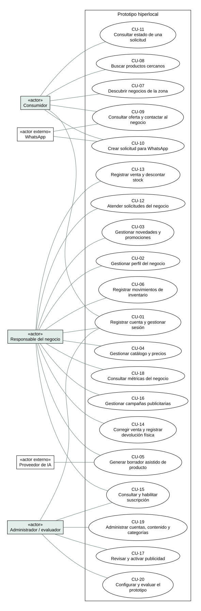

Fuente: elaboración propia. [Código PlantUML](diagramas/casos-de-uso.puml). Las fichas están en [casos de uso](03-casos-de-uso.md).

### Vista por actor: Consumidor

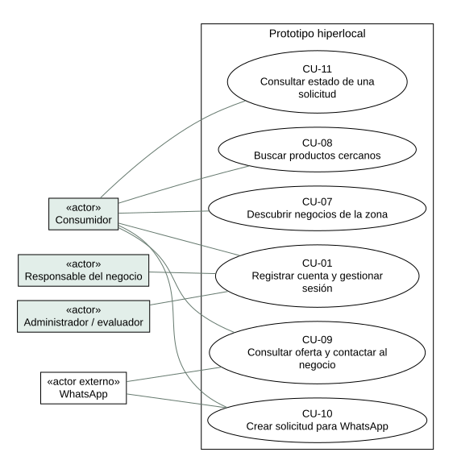

Fuente: elaboración propia. Es un desglose del mismo conjunto de casos, no funciones adicionales.

### Vista por actor: Responsable del negocio

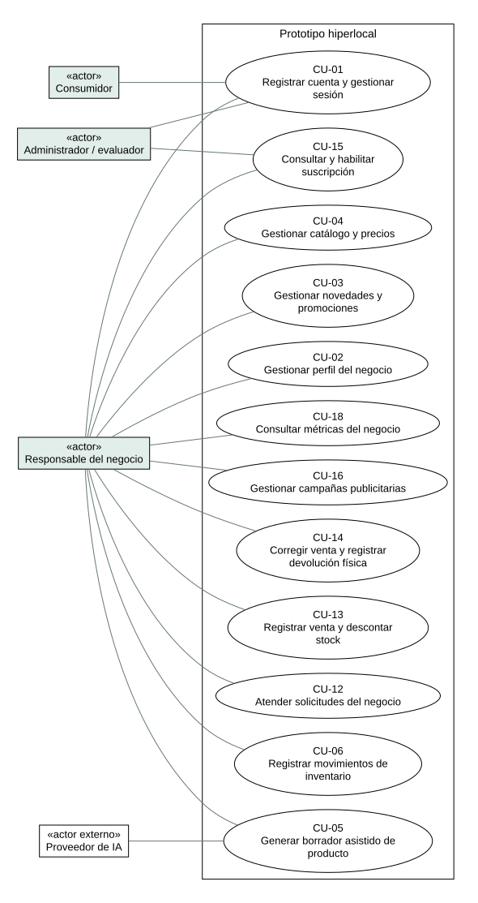

Fuente: elaboración propia. Es un desglose del mismo conjunto de casos, no funciones adicionales.

### Vista por actor: Administrador y evaluación

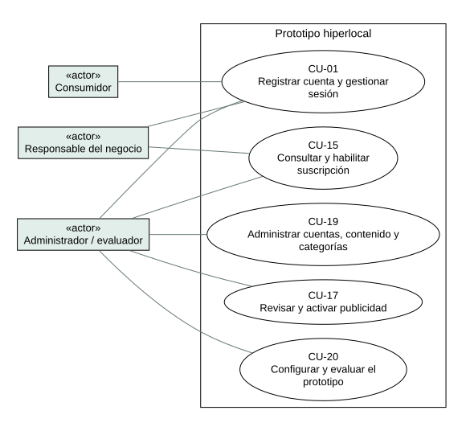

Fuente: elaboración propia. Es un desglose del mismo conjunto de casos, no funciones adicionales.

## Diagramas de secuencia

Se seleccionan los recorridos que concentran el aporte técnico y las integraciones. No se interpreta que todos los casos de uso deban tener una secuencia independiente; todos sí tienen ficha.

### S01 — Descubrir negocios y registrar exposición

Trazabilidad: CU-07, RF-21, RF-22.

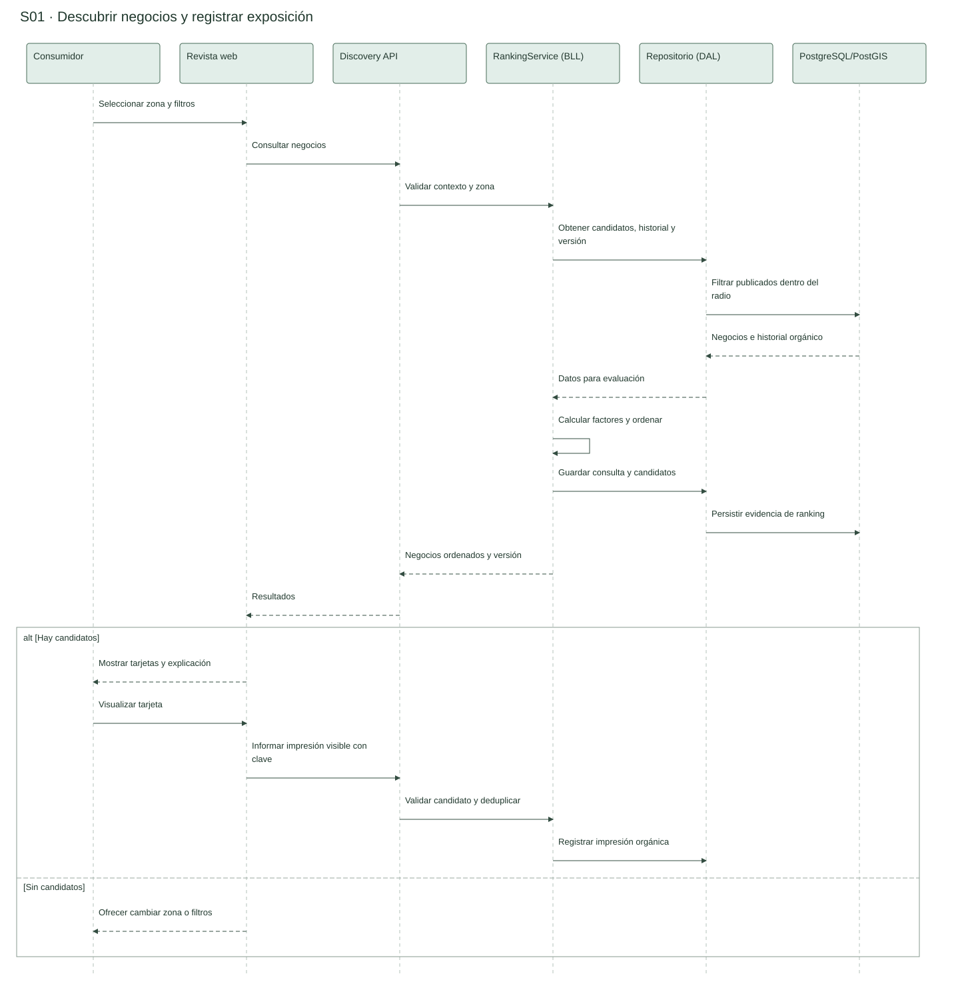

Fuente: elaboración propia. [Código PlantUML](diagramas/S01.puml).

### S02 — Buscar productos disponibles

Trazabilidad: CU-08.

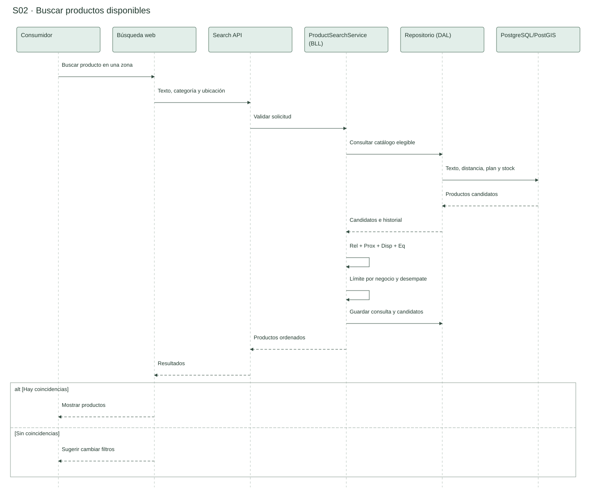

Fuente: elaboración propia. [Código PlantUML](diagramas/S02.puml).

### S03 — Crear solicitud y preparar WhatsApp

Trazabilidad: CU-09, CU-10, CU-11.

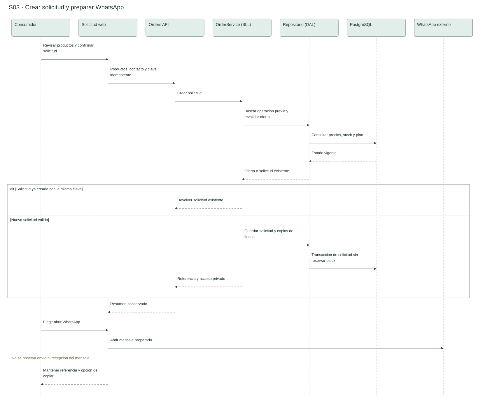

Fuente: elaboración propia. [Código PlantUML](diagramas/S03.puml).

### S04 — Registrar venta con integridad

Trazabilidad: CU-13, RNF-02, RNF-03.

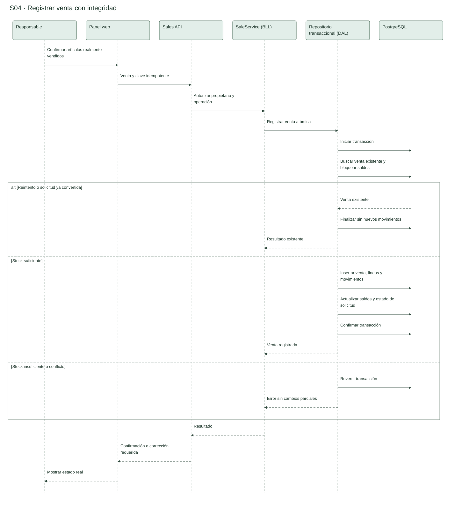

Fuente: elaboración propia. [Código PlantUML](diagramas/S04.puml).

### S05 — Asistencia de catálogo con revisión humana

Trazabilidad: CU-04, CU-05.

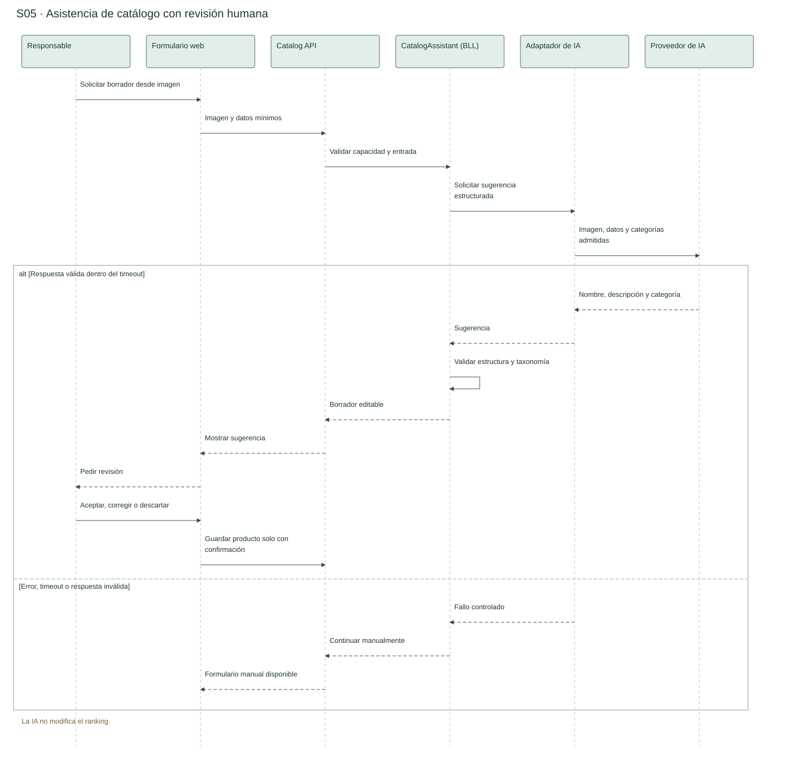

Fuente: elaboración propia. [Código PlantUML](diagramas/S05.puml).

### S06 — Habilitar suscripción y verificar capacidades

Trazabilidad: CU-15.

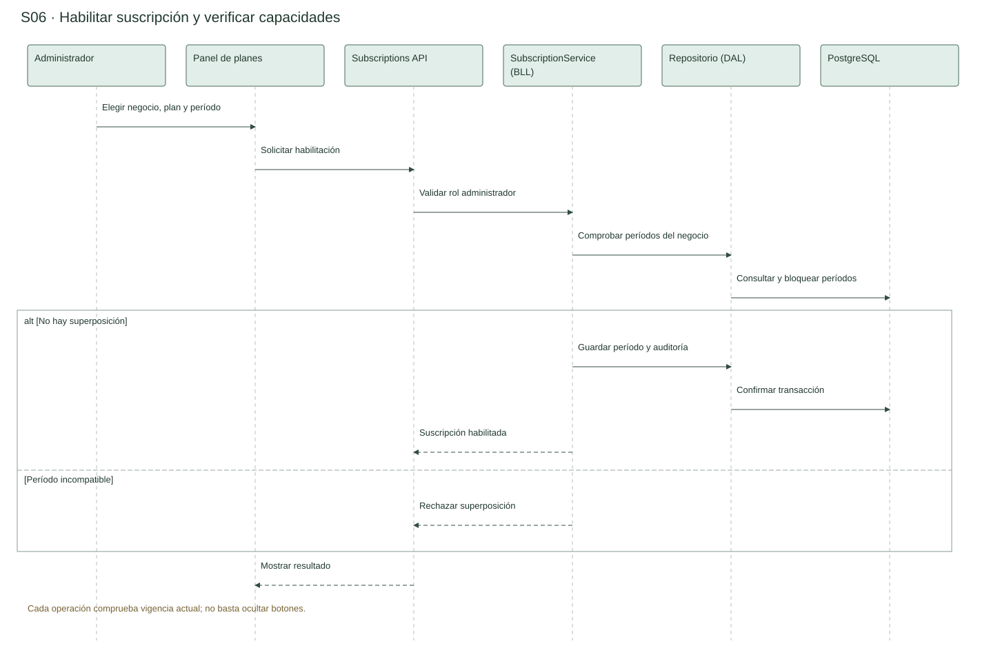

Fuente: elaboración propia. [Código PlantUML](diagramas/S06.puml).

### S07 — Solicitar y activar campaña

Trazabilidad: CU-16, CU-17.

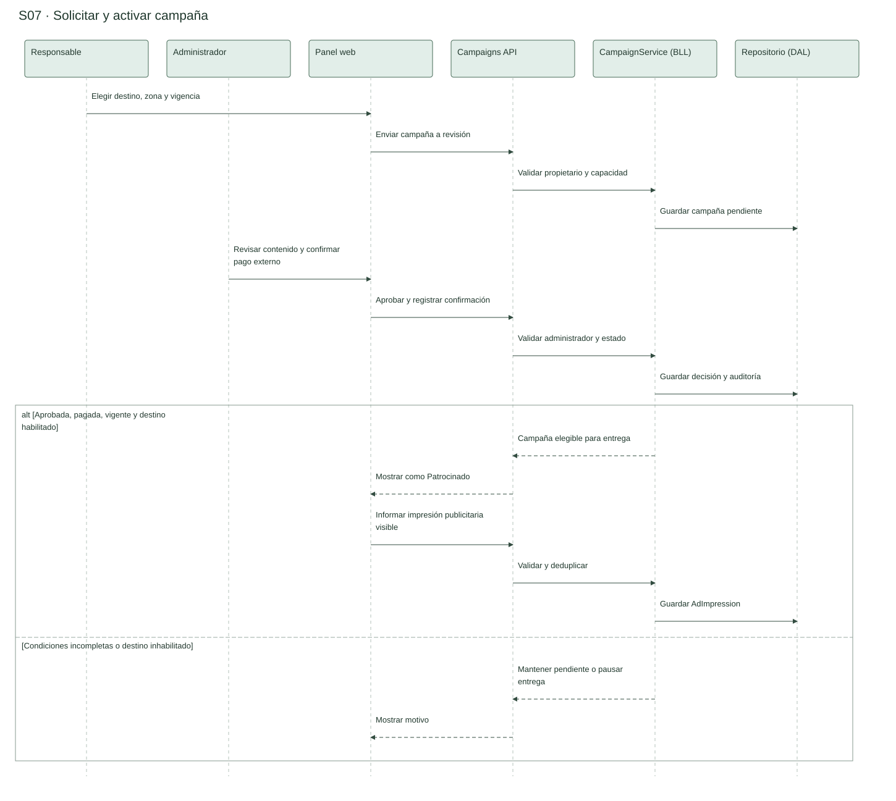

Fuente: elaboración propia. [Código PlantUML](diagramas/S07.puml).

### S08 — Anular venta y registrar devolución

Trazabilidad: CU-14.

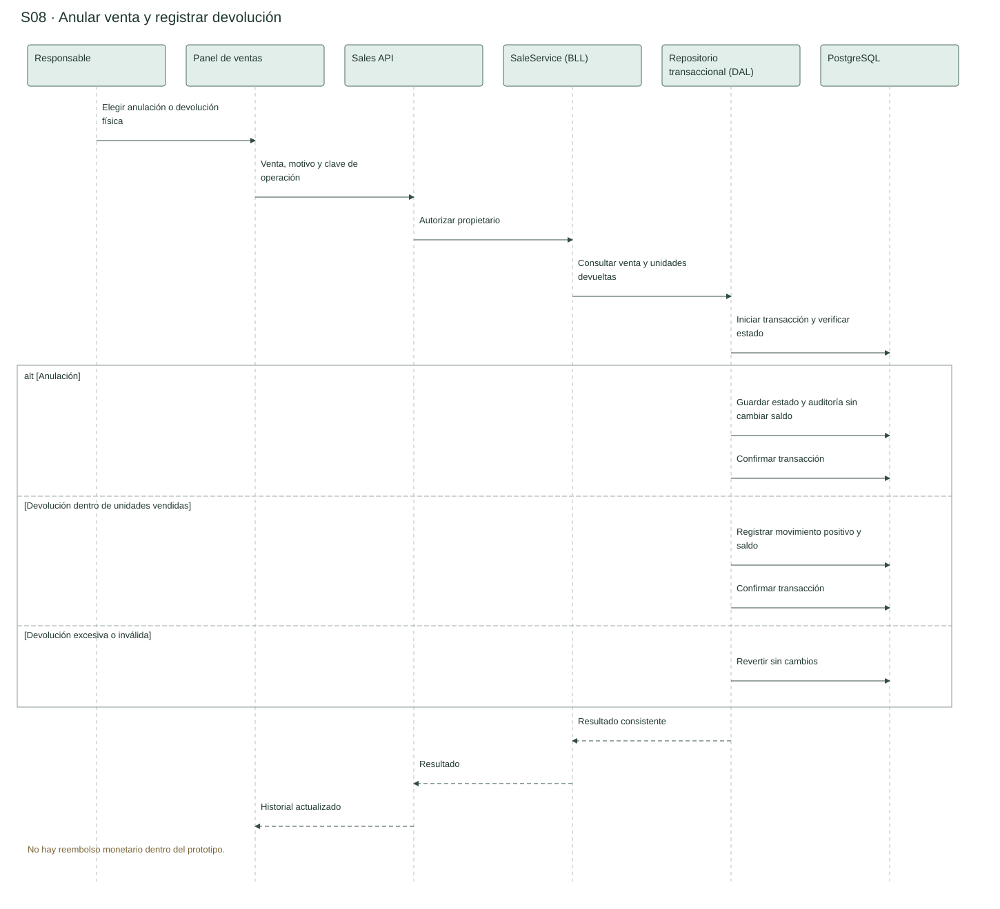

Fuente: elaboración propia. [Código PlantUML](diagramas/S08.puml).

## Estructura de datos

Se utilizan **clases y DER** porque el sistema se diseña orientado a objetos y almacena datos relacionales. El diagrama de clases representa atributos, operaciones de dominio y asociaciones. El DER representa entidades persistentes, claves y cardinalidades. No son intercambiables: por ejemplo, un método de dominio no corresponde a una columna.

El modelo tiene 26 entidades y 203 campos, incluyendo sesiones y auditoría. Se omiten detalles internos del proveedor de autenticación hasta elegir su implementación; cualquier mapeo posterior debe preservar revocación y seguridad del contrato. La IA produce borradores transitorios y su evidencia de evaluación se conserva como archivos del experimento; no se crea una tabla de sugerencias sin necesidad funcional.

Las referencias, nulabilidad, índices y reglas de integridad complementan las figuras. Los importes del catálogo no son precios de suscripción: estos últimos se dejan sin definir.

- [Clases con operaciones y figuras por módulo](../model/classes.md).
- [DER completo y por módulo](../model/ER.md).
- [Diccionario de restricciones](../model/data-dictionary.md).
- [Diccionario por campo: nombre, descripción, longitud y tipo](../model/field-dictionary.md).

## Proceso de negocio propuesto en BPMN

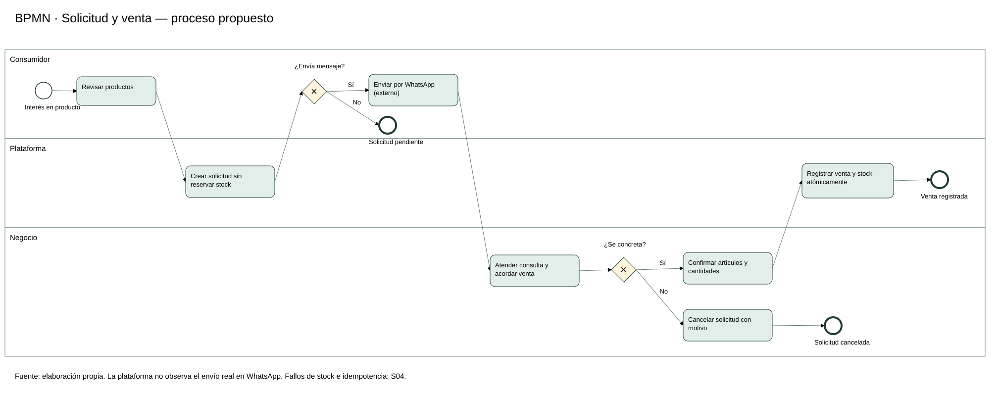

Fuente: elaboración propia. [Fuente BPMN 2.0 no ejecutable con coordenadas](diagramas/proceso-solicitud-venta.bpmn).

El modelo distingue consumidor, plataforma y negocio mediante carriles de un proceso de colaboración operativa. Si el consumidor no envía el mensaje, la solicitud queda pendiente; si el negocio informa venta, el sistema registra venta y stock atómicamente. La conversación externa no es observada automáticamente por la plataforma. Se presenta el proceso propuesto; el diagnóstico conserva los nombres de los procesos actuales. El tratamiento técnico de fallos y concurrencia se detalla en S04. La exportación XML es estructuralmente verificable; su importación visual en un editor BPMN específico no se ha probado.

## Diagrama de componentes

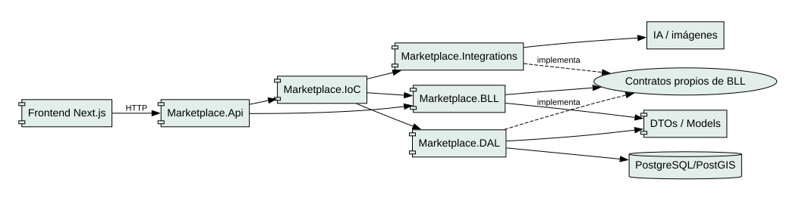

Fuente: elaboración propia. [Código PlantUML](diagramas/componentes.puml).

La API expone casos de uso; BLL concentra las reglas e interfaces; DAL implementa persistencia; IoC conecta implementaciones. El proyecto de integraciones se agrega cuando se implemente asistencia de IA y almacenamiento de imágenes. BLL no referencia DAL ni SDKs externos. Se mantiene el [ADR de arquitectura](../architecture/ADR-001-layered-architecture.md).

## Diagrama de despliegue

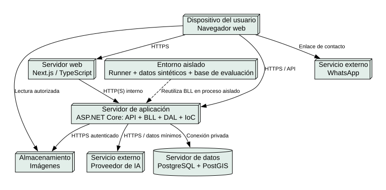

Fuente: elaboración propia. [Código PlantUML](diagramas/despliegue.puml).

El consumidor y el negocio acceden mediante navegador al frontend Next.js. El frontend y las interacciones del navegador consumen la API ASP.NET Core; el backend aplica permisos y reglas y consulta PostgreSQL/PostGIS por conexión privada. Las imágenes se guardan en almacenamiento de objetos y se exponen mediante referencias de lectura controladas. El backend invoca al proveedor de IA con datos mínimos, mientras que WhatsApp se abre desde el dispositivo como servicio externo.

El evaluador ejecuta el mismo núcleo de ranking en un proceso aislado con su propia base y datos sintéticos. No ejecuta simulaciones sobre los registros comerciales. La flecha discontinua representa reutilización lógica, no acceso del runner a la API de producción. Proveedores, dominios, capacidades y mecanismos de respaldo se elegirán en el diseño de despliegue; no hay contratación ni publicación implícita.

