# Prototipos de interfaces

Maquetas estáticas de baja fidelidad, con datos ficticios. No implementan el producto ni conectan con servicios externos. Los enlaces solo permiten revisar el encadenamiento propuesto. [Abrir galería navegable](pantallas/index.html).

## P01 — Tu cuenta

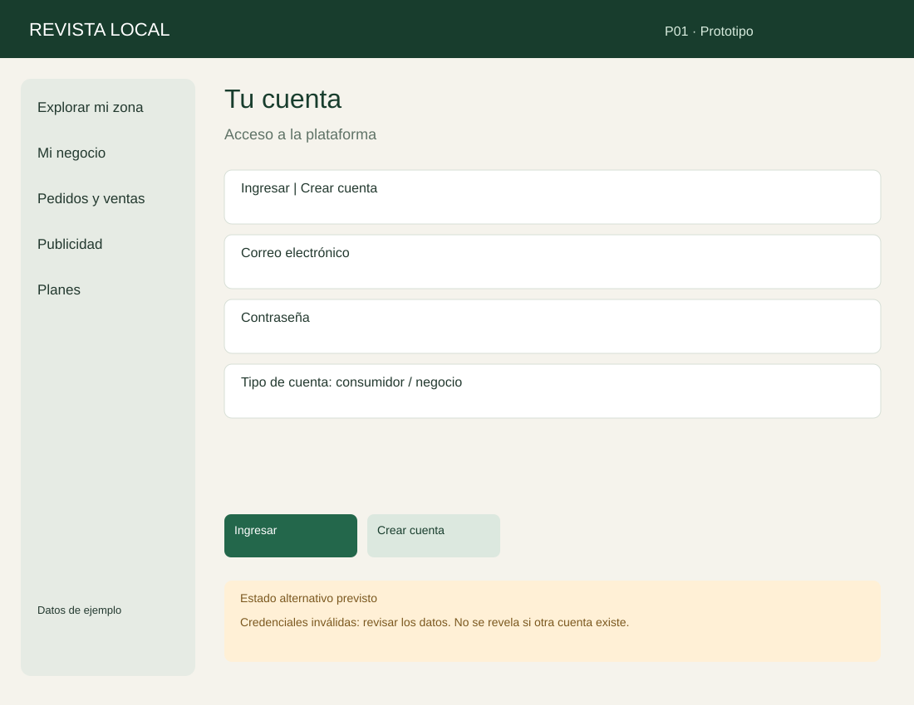

CU-01. Acceso a la plataforma.

Recorrido: Ingresar → P07; Crear cuenta → P02.

Alternativa: Credenciales inválidas: revisar los datos. No se revela si otra cuenta existe.

Fuente: elaboración propia.

## P02 — Mi negocio

CU-02. Identidad y ubicación.

Recorrido: Guardar perfil → P02; Ver mi negocio → P09.

Alternativa: Falta ubicación: podés guardar borrador antes de publicar.

Fuente: elaboración propia.

## P03 — Novedades y promociones

CU-03. Contá qué hay de nuevo.

Recorrido: Guardar borrador → P03; Publicar → P09; Promocionar → P16.

Alternativa: La fecha de finalización debe ser posterior al inicio.

Fuente: elaboración propia.

## P04 — Mi catálogo

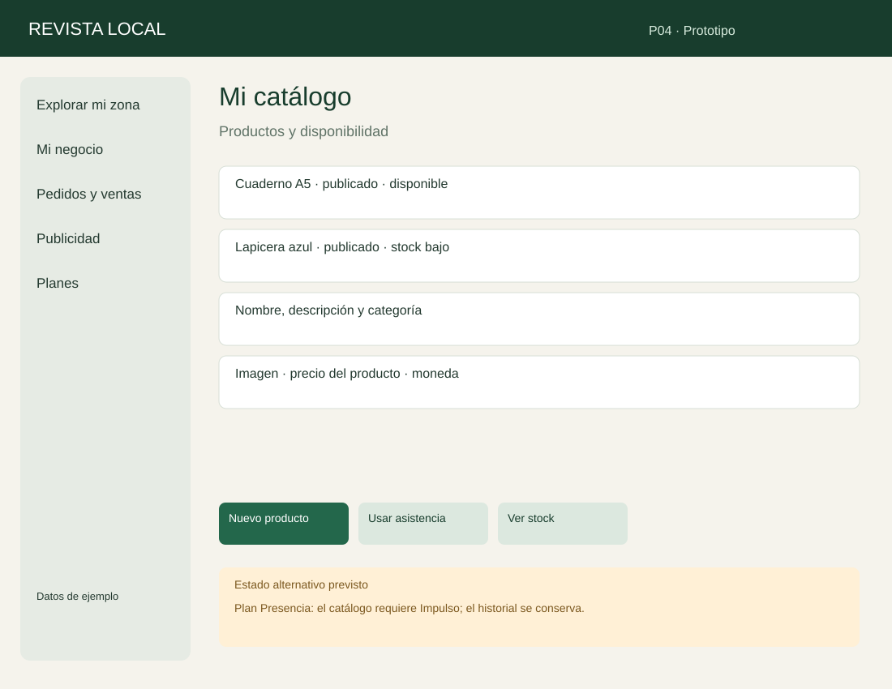

CU-04. Productos y disponibilidad.

Recorrido: Nuevo producto → P04; Usar asistencia → P05; Ver stock → P06.

Alternativa: Plan Presencia: el catálogo requiere Impulso; el historial se conserva.

Fuente: elaboración propia.

## P05 — Asistencia de catálogo

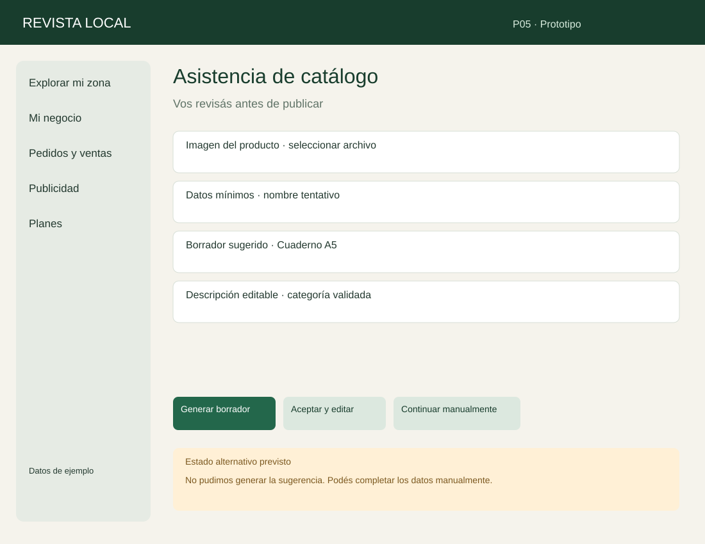

CU-05. Vos revisás antes de publicar.

Recorrido: Generar borrador → P05; Aceptar y editar → P04; Continuar manualmente → P04.

Alternativa: No pudimos generar la sugerencia. Podés completar los datos manualmente.

Fuente: elaboración propia.

## P06 — Inventario

CU-06. Cada cambio queda registrado.

Recorrido: Registrar movimiento → P06; Ver catálogo → P04.

Alternativa: El ajuste no puede dejar el stock por debajo de cero.

Fuente: elaboración propia.

## P07 — Descubrí tu zona

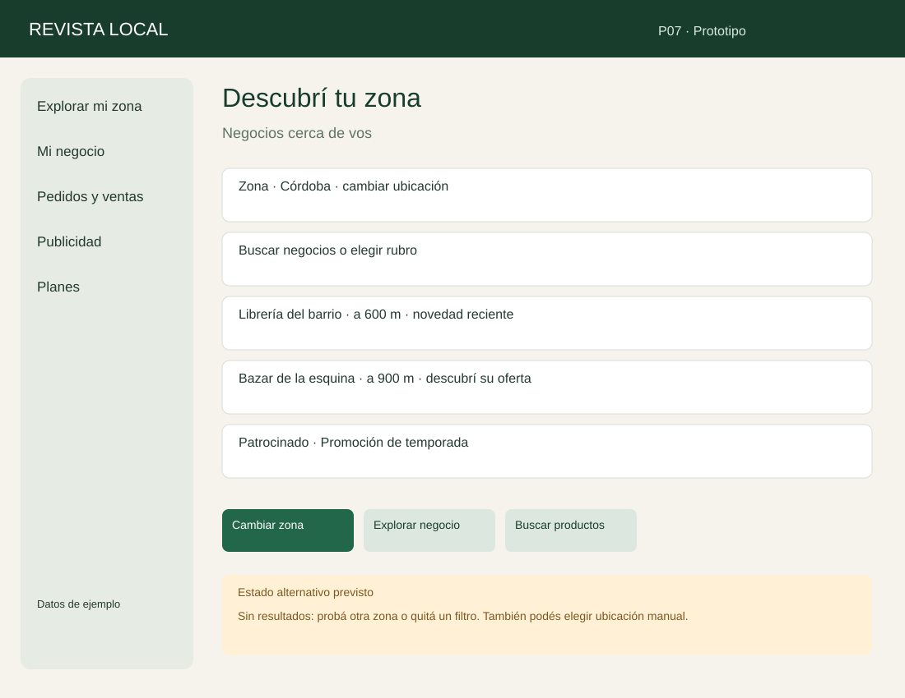

CU-07. Negocios cerca de vos.

Recorrido: Cambiar zona → P07; Explorar negocio → P09; Buscar productos → P08.

Alternativa: Sin resultados: probá otra zona o quitá un filtro. También podés elegir ubicación manual.

Fuente: elaboración propia.

## P08 — Productos cercanos

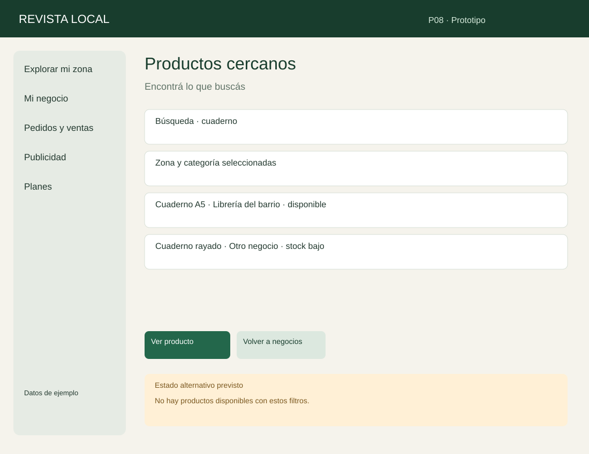

CU-08. Encontrá lo que buscás.

Recorrido: Ver producto → P09; Volver a negocios → P07.

Alternativa: No hay productos disponibles con estos filtros.

Fuente: elaboración propia.

## P09 — Librería del barrio

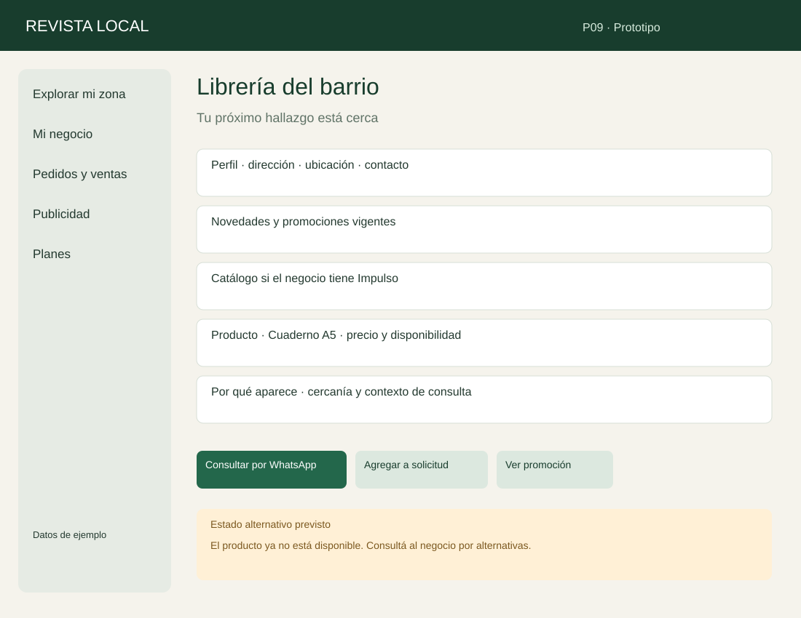

CU-09. Tu próximo hallazgo está cerca.

Recorrido: Consultar por WhatsApp → P09; Agregar a solicitud → P10; Ver promoción → P09.

Alternativa: El producto ya no está disponible. Consultá al negocio por alternativas.

Fuente: elaboración propia.

## P10 — Tu solicitud

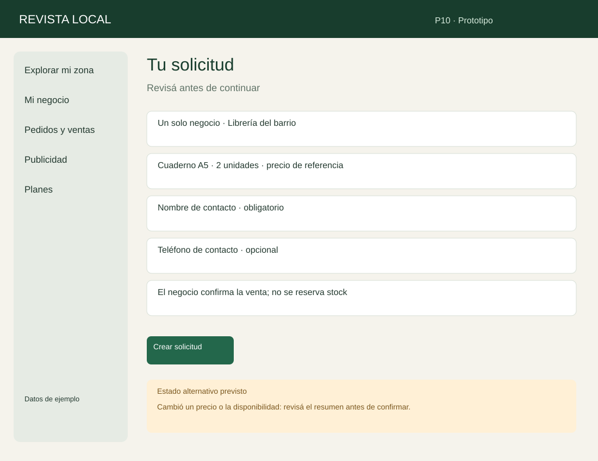

CU-10. Revisá antes de continuar.

Recorrido: Crear solicitud → P11.

Alternativa: Cambió un precio o la disponibilidad: revisá el resumen antes de confirmar.

Fuente: elaboración propia.

## P11 — Solicitud creada

CU-11. Referencia · ABC123 · ejemplo.

Recorrido: Abrir WhatsApp → P11; Copiar resumen → P11; Volver a explorar → P07.

Alternativa: No se pudo abrir WhatsApp. Tu solicitud sigue guardada.

Fuente: elaboración propia.

## P12 — Solicitudes

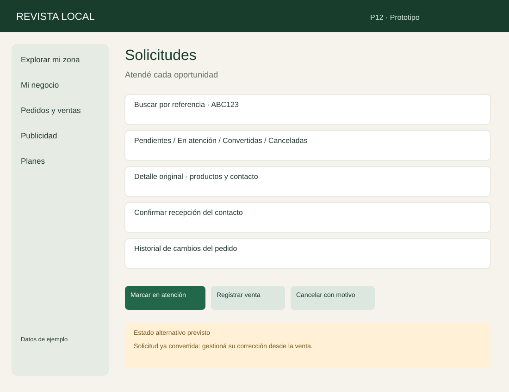

CU-12. Atendé cada oportunidad.

Recorrido: Marcar en atención → P12; Registrar venta → P13; Cancelar con motivo → P12.

Alternativa: Solicitud ya convertida: gestioná su corrección desde la venta.

Fuente: elaboración propia.

## P13 — Registrar venta

CU-13. Confirmá lo efectivamente vendido.

Recorrido: Confirmar venta → P14; Volver a solicitud → P12.

Alternativa: Stock insuficiente: no se registró la venta ni se descontaron unidades.

Fuente: elaboración propia.

## P14 — Venta e historial

CU-14. Registro conservado.

Recorrido: Anular con motivo → P14; Registrar devolución → P14; Ver métricas → P18.

Alternativa: Anular no repone stock; solo la devolución física registra unidades recibidas.

Fuente: elaboración propia.

## P15 — Planes para tu negocio

CU-15. Presencia / Impulso.

Recorrido: Consultar ventajas → P15; Habilitar período (admin) → P15; Volver al panel → P02.

Alternativa: El período se superpone con otra suscripción. No se habilitó.

Fuente: elaboración propia.

## P16 — Promocioná tu oferta

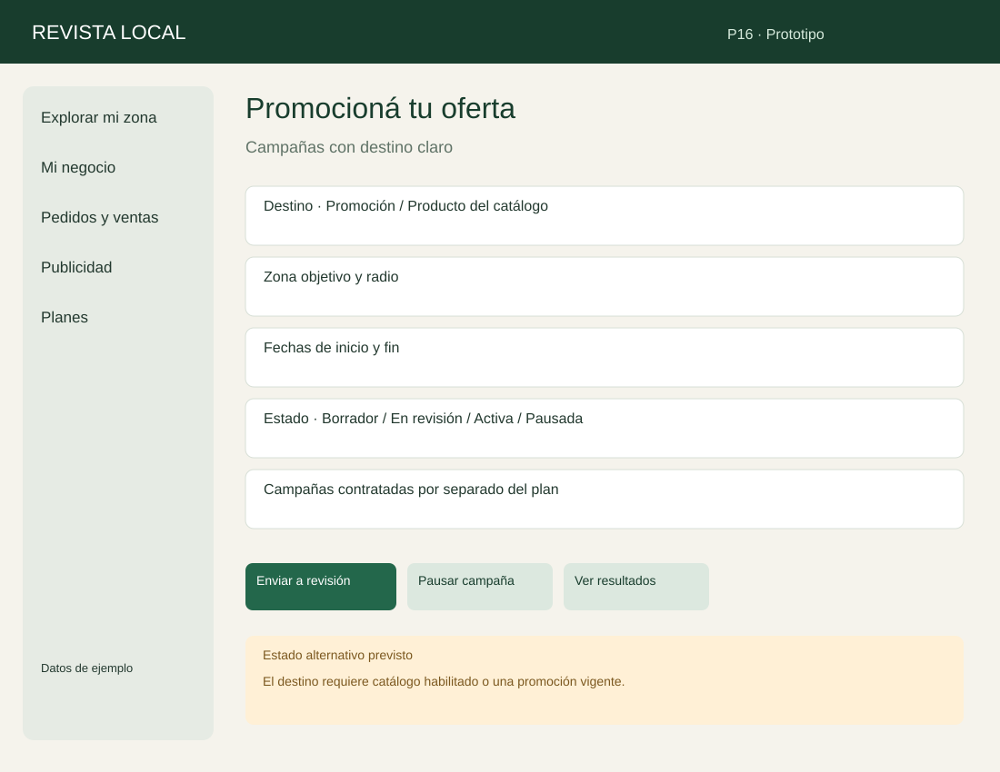

CU-16. Campañas con destino claro.

Recorrido: Enviar a revisión → P16; Pausar campaña → P16; Ver resultados → P18.

Alternativa: El destino requiere catálogo habilitado o una promoción vigente.

Fuente: elaboración propia.

## P17 — Revisión de campañas

CU-17. Panel de administración.

Recorrido: Aprobar → P17; Rechazar con motivo → P17; Confirmar pago y programar → P17.

Alternativa: Falta confirmar el pago: la campaña sigue sin mostrarse.

Fuente: elaboración propia.

## P18 — Resultados de tu negocio

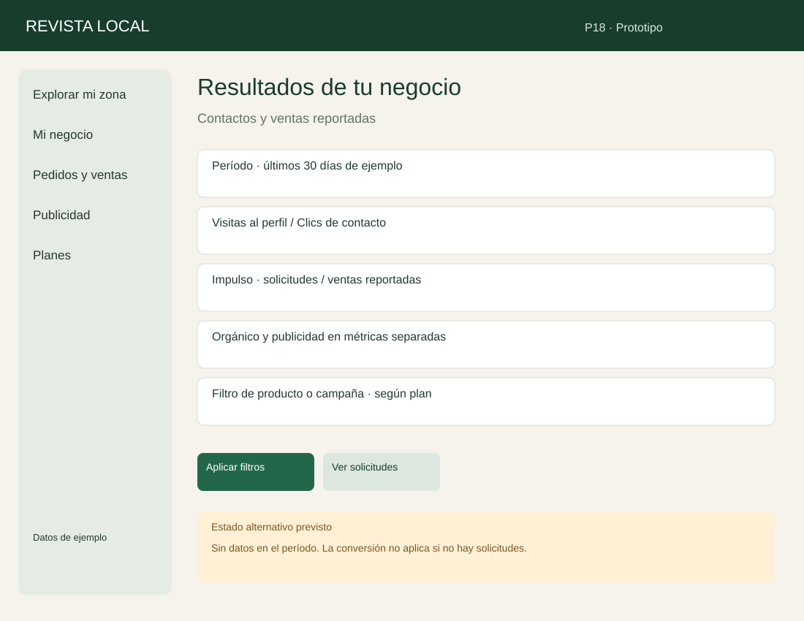

CU-18. Contactos y ventas reportadas.

Recorrido: Aplicar filtros → P18; Ver solicitudes → P12.

Alternativa: Sin datos en el período. La conversión no aplica si no hay solicitudes.

Fuente: elaboración propia.

## P19 — Administración

CU-19. Cuentas, contenido y categorías.

Recorrido: Guardar decisión → P19; Gestionar planes → P15; Revisar campañas → P17.

Alternativa: No se puede eliminar una categoría referenciada ni suspender al último administrador.

Fuente: elaboración propia.

## P20 — Evaluación del prototipo

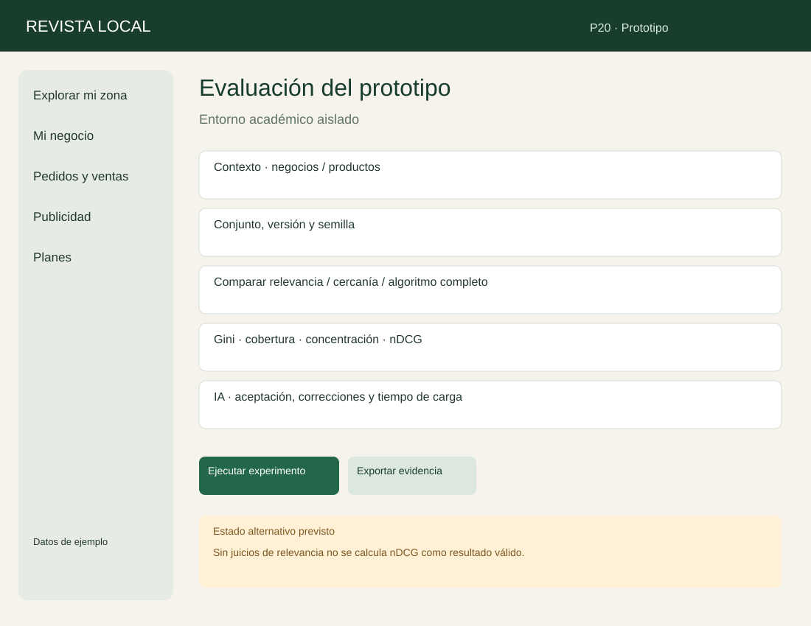

CU-20. Entorno académico aislado.

Recorrido: Ejecutar experimento → P20; Exportar evidencia → P20.

Alternativa: Sin juicios de relevancia no se calcula nDCG como resultado válido.

Fuente: elaboración propia.
