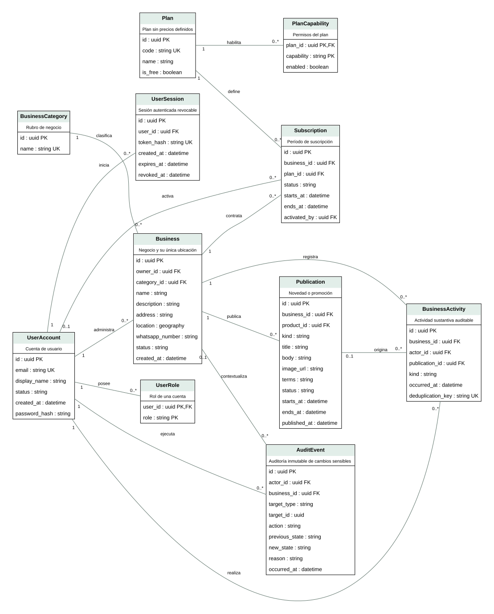
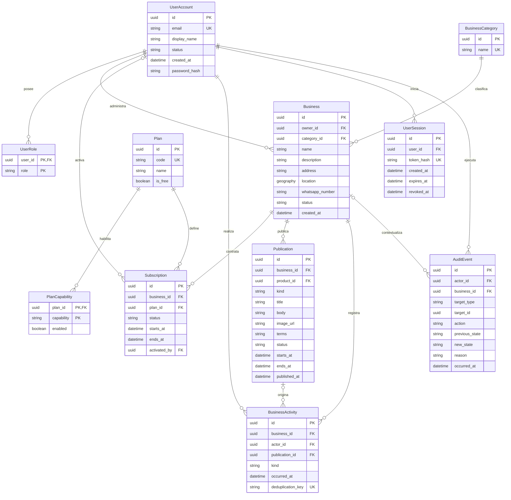
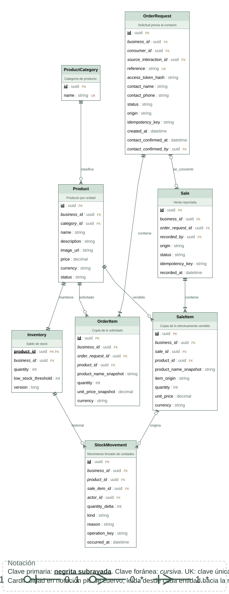
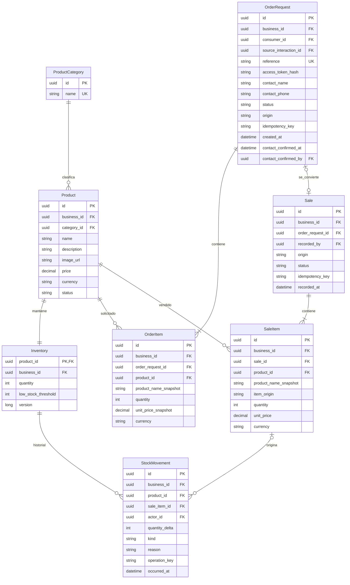
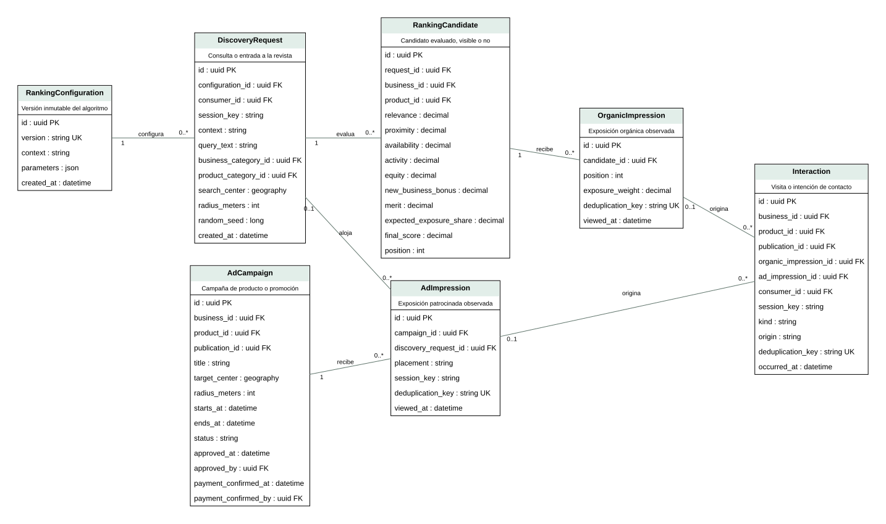
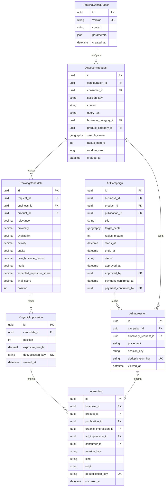

# Diagramas entidad-relación

Modelo propuesto orientado a PostgreSQL/PostGIS. Las FK compuestas y restricciones condicionales se detallan en el [diccionario](data-dictionary.md). El [diccionario por campo](field-dictionary.md) fija tipos y longitudes propuestos. Las figuras DOT/SVG y las fuentes Mermaid se generan desde [model.json](model.json); no son migraciones ejecutadas.

## Negocios, identidad y planes

Fuente: elaboración propia. Se omiten aristas externas al módulo para facilitar lectura; ver el modelo completo.

## Catálogo, solicitudes, ventas e inventario

Fuente: elaboración propia. Se omiten aristas externas al módulo para facilitar lectura; ver el modelo completo.

## Ranking, campañas y medición

Fuente: elaboración propia. Se omiten aristas externas al módulo para facilitar lectura; ver el modelo completo.

