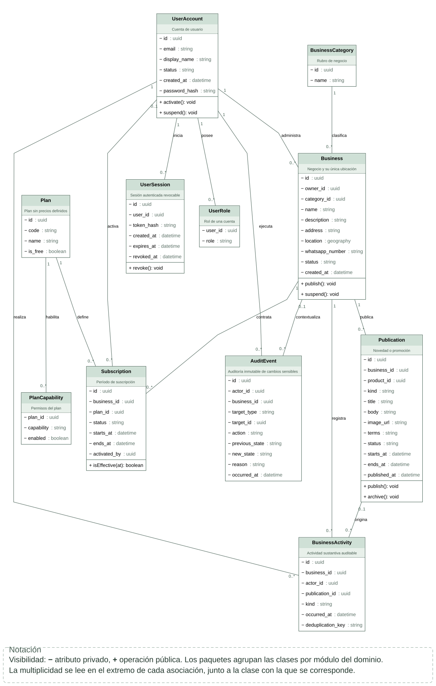
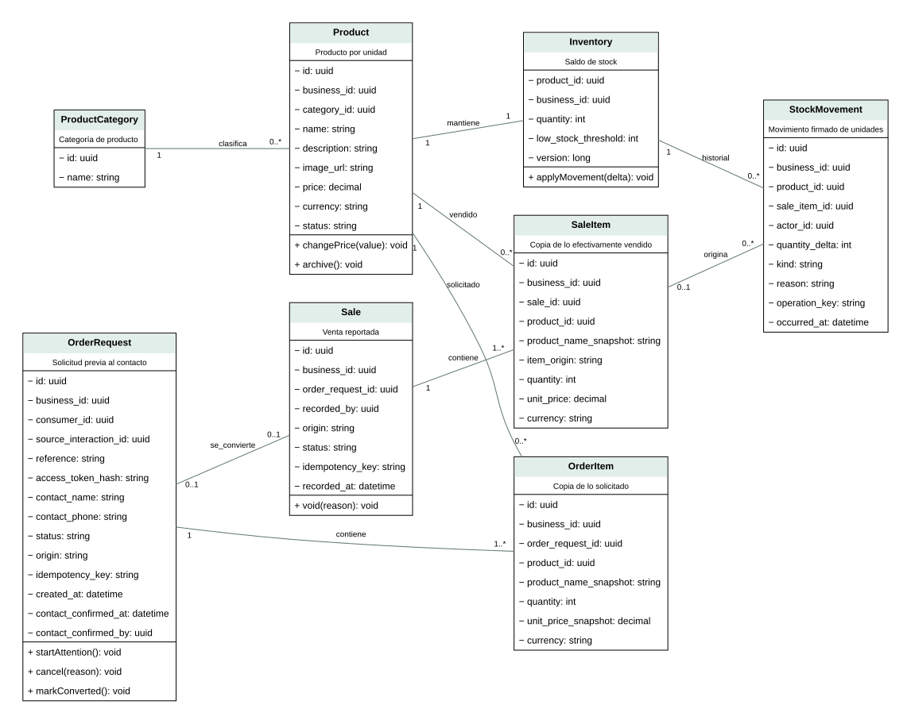
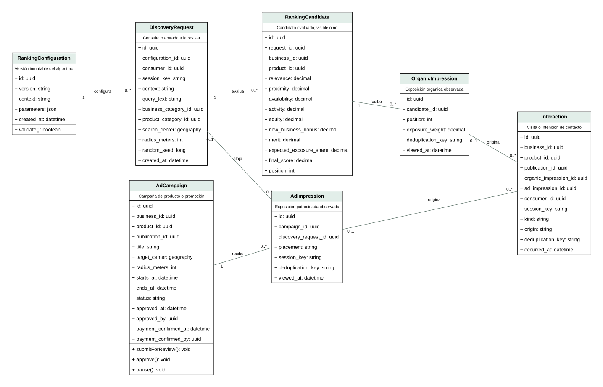

# Diagrama de clases

Se elige UML por el diseño orientado a objetos. Las clases incluyen atributos, operaciones de dominio y multiplicidades; los servicios de aplicación coordinan las transacciones entre entidades. No se interpreta cada método como una tabla o endpoint. Fuente completa: [entities.puml](entities.puml).

## Negocios, identidad y planes

Fuente: elaboración propia. [Código PlantUML](01-negocios.puml). Las relaciones externas se incluyen en la fuente completa.

## Catálogo, solicitudes, ventas e inventario

Fuente: elaboración propia. [Código PlantUML](02-comercio.puml). Las relaciones externas se incluyen en la fuente completa.

## Ranking, campañas y medición

Fuente: elaboración propia. [Código PlantUML](03-descubrimiento.puml). Las relaciones externas se incluyen en la fuente completa.
